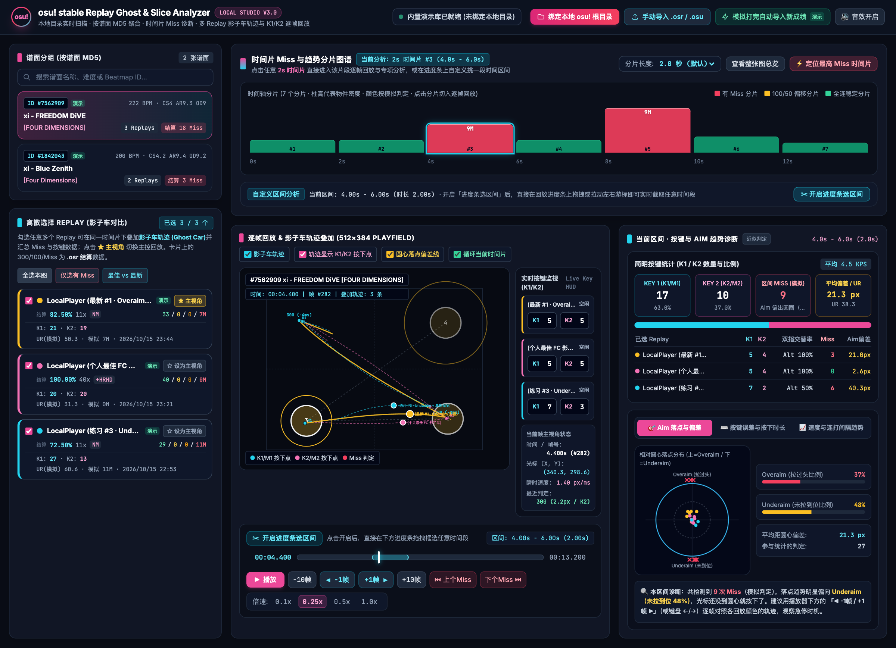

<div align="center">

# osu-replay-ghost

**在浏览器里分析 osu! stable 回放：按时间片定位 Miss，多条回放影子车轨迹叠加，K1/K2 逐帧回放**

简体中文 | [English](README.en.md)


</div>



## 这是什么

打完一张图，想知道到底是哪几秒断的、是拉过头还是没拉到位、是不是单指连打跟不上？这个工具把 osu! stable 的 `.osr` 回放和 `.osu` 谱面读进浏览器，把整张图切成若干时间片统计 Miss，然后在 512×384 的 playfield 上逐帧回放。你可以把最新一局和个人最佳叠在一起看，两条轨迹在哪里分开一目了然。

所有解析和计算都在本地浏览器里完成，**不上传任何文件**，构建后断网也能使用。

## 功能

- **谱面浏览与按需读取回放**（谱面信息和回放预览完全分开）
  - 绑定 osu! 根目录后读取 `osu!.db`，并列出一次 `Data/r/` 的文件名。文件名就是「谱面 MD5-时间戳」，所以不用打开任何回放就能得到「最近游玩」列表。
  - 「搜索」支持 Beatmap ID、谱面集 ID、osu! 链接（`/b/`、`/beatmapsets/…#osu/…`、`b:123`、`s:123`）、MD5，以及标题、艺术家、作者、难度名、标签关键词。
  - 选中一张谱面后，才从 `Songs/` 读取它的 `.osu`，再临时读取它在 `Data/r/` 和 `Replays/` 中的本地回放（先读最新 30 条，可以继续加载更早的）。`Replays/` 的文件名不含 MD5，第一次会读取每个文件开头 128 字节来匹配，之后只读新增的文件。
  - 打完一局后，这张图会出现在「最近游玩」顶部并标「新」。如果当前正在预览的就是这张图，新回放会直接加入对比，并设为主视角。
  - 新成绩靠 `FileSystemObserver`（Chrome / Edge 133+）的文件变化事件发现，平时不扫描目录。不支持该 API 的浏览器改为定时列出文件名：没有变化时间隔从 3 秒逐渐放宽到 15 秒，页面在后台时暂停，回到页面立即检查。
  - 游戏退出时才会写入 `osu!.db`，所以本次游戏期间新下载的谱面可能还不在里面。打开这种谱面时，只会计算 `Songs/` 中 `osu!.db` 未收录的文件夹的 MD5 来查找。
  - 从浏览器打开的谱面只在内存里保留最近几张，更早的会连同回放一起释放。
  - 也可以手动选择文件，或直接把 `.osr` / `.osu` / `osu!.db` 拖到页面任意位置。
- **按谱面分组**：以谱面 MD5 分组，同一个 BeatmapID 的不同版本会分开显示；找不到谱面的回放进入「待匹配」列表，导入对应 `.osu` 后自动归位。
- **时间片诊断**
  - 按 1 / 2 / 3 / 5 秒切片，柱子颜色表示有 Miss、有滑条断连、有 100/50 或全连。
  - 一键定位 Miss 最多的时间片（Miss 数相同时看断连）。
  - 也可以在进度条上拖选任意区间（支持触屏）。
  - 主进度条下方有一条「区间细分条」，只显示当前区间（两侧各留 10%、至少 100 ms 的余量），并标出主视角回放的 Miss、断连和 100/50，鼠标悬停可以看原因。点击跳转；拖动框选一个子区间就放大到它，可以一层层往下细分，用「返回上一区间」逐级退回；拖两端手柄微调起止点。
- **影子车回放**
  - 多条回放的光标轨迹叠加显示，同时标出 K1/K2 按下点和圆心到落点的偏差线。
  - 滑条断连处会画出跟随圈，并标出没跟住的 tick / 折返 / 滑条尾、当时光标的位置和原因（松键、出跟随圈、没跟上）。
  - 按回放的真实帧逐帧步进，可以跳到上一个/下一个 Miss 或断连，0.1x–1.0x 变速播放，并带合成打击音效。
- **区间分析**
  - K1/K2 数量与比例、KPS、UR、双指交替率、平均偏差。
  - Overaim / Underaim 落点雷达图。
  - 打击误差直方图、按下时长。
  - 光标速度曲线（多条回放在同一时间轴上对齐）与连打间隔。
- **Mods**：HR / EZ 会修正 CS、AR、OD；HR 回放的坐标会翻转回谱面坐标系，所以开不同 mods 的回放也能叠在一起对比。
- **演示模式**：内置 2 张演示谱面和 5 条合成回放，打开页面就能看到效果。所有演示数据都标有「演示」，导入真实数据后可以一键清除。

## 快速开始

需要 Node.js 20.19+ 或 22.12+。

```bash
git clone https://github.com/M1zukiqwq/osu-replay-ghost.git
cd osu-replay-ghost
npm install
npm run dev
```

用浏览器打开 <http://localhost:5173>。

构建可以离线使用的静态版本：

```bash
npm run build      # 输出到 dist/
npm run preview    # 本地预览 dist/
```

`dist/` 是纯静态文件，可以部署到任何静态托管服务（需要 HTTPS 才能使用目录绑定）。

## 使用方法

### 方式一：绑定 osu! 目录（推荐）

1. 用 **Chrome 或 Edge** 打开页面（目录绑定依赖 File System Access API）。
2. 点击顶栏「绑定本地 osu! 根目录」，选择 osu! stable 的安装目录：
   - Windows 默认位置：`%LOCALAPPDATA%\osu!`
   - macOS（Wine 封装版）：`/Applications/osu!.app/Contents/Resources/drive_c/Program Files/osu!/`。在选择框里按 <kbd>⌘</kbd><kbd>⇧</kbd><kbd>G</kbd> 可以直接输入路径。
3. 绑定后，左侧「谱面浏览」会切到「最近游玩」。点一张谱面，右侧才会读取它的本地回放；也可以在「搜索」里按 ID 或关键词找谱面。
4. 之后每打完一局，这张图会出现在「最近游玩」顶部。如果当前正在看的就是这张图，新回放会直接加进来。
5. 如果 osu! 配置里的 Songs 目录在根目录之外，顶栏会出现「授权 Songs 目录」按钮；如果没有 `osu!.db`，可以点「扫描 Songs」逐个计算 MD5 来匹配谱面（较慢，在后台线程中进行）。

刷新页面后，点击「恢复绑定」并重新授权即可，不用重新选择目录。

### 方式二：手动导入

点击「手动导入 .osr / .osu」，或者直接把文件拖进页面。回放会按谱面 MD5 自动找到对应的谱面。导入结束后会弹出汇总通知，点「查看明细」可以看到每个文件的结果和失败原因。

### 分析一局回放

1. 在左侧选择谱面，勾选要对比的回放，点 ★ 设置主视角（播放音效、跳 Miss / 断连、UR 等以主视角为准）。新打开的谱面默认选中「最新一局」和「结算准确率最高的一局」。
2. 在时间片图上点 Miss 最多的柱子，或者点「⚡ 定位最高 Miss 时间片」。
3. 用 <kbd>Space</kbd> 播放/暂停，<kbd>←</kbd> / <kbd>→</kbd> 逐帧，<kbd>Shift</kbd> + 方向键一次跳 10 帧。
4. 在右侧切换 Aim / 按键 / 速度三个 Tab 查看这个区间的统计。

## 数据口径

- **结算数据与模拟判定是两套数据。**
  - 回放卡片和谱面卡片上的 300 / 100 / Miss 来自 `.osr` 文件头，即游戏的结算结果，标注为「结算」。
  - 时间片和分析面板里的 Miss、偏差、打击误差，则来自本工具对光标轨迹重新做的判定，标注为「模拟」，两者可能不一致。
- **模拟判定是近似模型**：
  - 判定圆圈和滑条头，带 notelock；点到圈外不算数，可以补点；提前 400 ms 以内按到算 Miss。
  - 滑条按 stable 规则模拟：
    - 滑条头只要落在 50 的时间窗内就算命中。
    - 滑条身用跟随圈判定：开始后按住任一键且光标进入圆圈半径才算抓住滑条球，之后只要一直按住、光标不离开 2.4 倍半径就保持跟随。
    - tick 和折返的位置与 osu! 的生成规则一致；版本低于 v8 的谱面计算 tick 间距时不乘 SV。滑条尾在结束前 36 ms 检查（但不早于滑条中点）。
    - 结果按命中部分的比例给出：全部命中为 300，至少一半为 100，有命中为 50，全部没中为 Miss。
  - **滑条断连**：滑条头、tick 或折返没跟住（滑条尾除外），但整条滑条不是 Miss。断连单独计数，不算进 Miss，这与游戏结算里的 Miss 数口径一致。
  - 转盘不参与 Aim 和时间判定。
  - 暂未计算堆叠偏移。
- **算不出来的数值一律显示「—」**，不会用默认值填充。例如区间内少于 2 个命中时，UR 显示「—」。
- 所有区间统计都使用半开区间 `[开始, 结束)`，落在分片边界上的物件只会计入一个分片。

## 开发

```bash
npm test             # 单元测试（Vitest）
npm run typecheck    # 类型检查
npm run smoke        # 构建后用无头 Chrome 跑端到端检查（屏蔽外网）
npm run perf         # 长谱面（5 分钟 / 1500 物件）的播放帧率与拖选卡顿检查
npm run fixtures     # 重新生成测试样本（需要 python3）
npm run screenshot   # 重新生成 docs/screenshot.png
```

`smoke`、`perf`、`screenshot` 默认使用 macOS 上的 Chrome，其他系统可以通过环境变量 `CHROME_PATH` 指定浏览器路径。

### 项目结构

```
src/
  core/        纯逻辑，不依赖 DOM，可在 Node 中测试
    binary/      带越界检查的二进制读写、MD5
    lzma/        LZMA 解码 / 编码（无第三方依赖）
    formats/     .osr / .osu / osu!.db 的解析与写出
    beatmap/     timing（红线 / 绿线）、滑条路径（L / P / B / C）、mods 难度修正
    replay/      帧解码、HR 坐标翻转、按键事件
    analysis/    判定、Aim 分解、统计指标、时间片、速度重采样
    demo/        种子随机数、合成回放、演示谱面
  worker/      Web Worker：LZMA 解压、osu!.db 解析、判定分析
  app/         状态与 action、导入流程、谱面库、目录监听（只记文件名）、谱面浏览、回放预览
  ui/          界面渲染（画布、图表、面板）
scripts/       测试样本生成、端到端检查、性能检查、截图
tests/         单元测试与样本（样本全部由脚本生成）
```

### 技术说明

- 技术栈：TypeScript、Vite、Tailwind CSS、Chart.js。字体和图表库都随项目打包，运行时不访问任何 CDN。
- 所有外部文本（谱面标题、玩家名、文件名等）都按纯文本渲染，代码中不使用 `innerHTML`，测试会检查这一点。
- 滑条路径的近似算法与 osu-framework 的 `PathApproximator` 一致（Catmull 型滑条使用和游戏相同的均匀 Catmull-Rom）。
- LZMA 读到 `.osr` 声明的解压大小即停止，与游戏使用的 7-Zip SDK 行为一致。
- 解压、解析和判定都在 Web Worker 中进行；渲染循环中的查找都使用二分查找。5 分钟、1500 个物件的谱面叠加 5 条回放，播放时可保持 60 fps。

## 已知限制

- 只支持 osu!standard 模式和 osu! stable 的本地回放，taiko / catch / mania 回放会被跳过并注明原因。
- 判定是近似模型（见「数据口径」），结果不一定和游戏完全一致。
- 目录绑定依赖 File System Access API，目前只有 Chromium 系浏览器（Chrome、Edge 等）支持；实时监听还需要 133 及以上版本的 `FileSystemObserver`，更早的版本会退回定时检查。其他浏览器只能通过文件夹选择框读取一次目录快照。
- `Data/r/` 文件名里的时间戳按 Windows FILETIME 或 .NET ticks 解析，取落在合理年份内的那一个，只用于「最近游玩」排序。
- 以下几项目前只用合成数据测试过，欢迎用真实数据反馈：
  - 绑定真实 stable 目录后的完整流程
  - HR 回放的坐标翻转
  - 在触屏设备上拖选区间

## 许可证与声明

本项目以 [MIT License](LICENSE) 开源。

osu! 是 ppy Pty Ltd 的商标。本项目是社区作品，与 ppy 没有任何关联，也未获得其认可。
